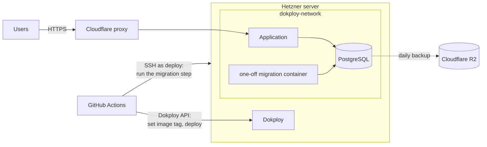

# Deployment

How Musialize's staging and production environments are set up, and what each piece is for. The pilot's own values (Group name, hostnames, passwords) are never written here: they live in Dokploy and in the maintainer's untracked local notes.

How a change travels from `main` to production is decided in [ADR-0004](adr/0004-promote-images-from-main-by-release-tag.md) (one image, promoted by release tag) and [ADR-0009](adr/0009-migration-bundles-as-a-separate-deploy-step.md) (migrations as a separate step).

## Overview



- One server (Hetzner) runs Dokploy, which runs everything on Docker Swarm.
- Dokploy has one project, `musialize`, with two environments: `staging` and `production`. Each has its own Application and its own PostgreSQL.
- PostgreSQL is never reachable from the internet. Only containers on Dokploy's internal network, `dokploy-network`, can reach it.

## Dokploy

### PostgreSQL

One PostgreSQL 18 service per environment (image `postgres:18`).

- **External Port stays empty**, so the database isn't published to the internet.
- Its **Internal Host** (in Internal Credentials) is its name on `dokploy-network`. The app and the migration step connect to that name, on port 5432.
- The admin user and password Dokploy creates are only used for setup and maintenance. The app and the migration step each have their own role (see [Database roles](#database-roles)).

### Application

One Application per environment.

| Setting                               | Value                                                                                | Why                                                                                                                                  |
| ------------------------------------- | ------------------------------------------------------------------------------------ | ------------------------------------------------------------------------------------------------------------------------------------ |
| Provider                              | Docker, image `ghcr.io/fekko-dev/musialize`                                          | CI builds the image once; nothing is built on the server. CI sets the tag on every deploy.                                           |
| Cluster Settings → Registry Selection | the GHCR registry (Settings → Registry)                                              | The image is private, so Dokploy needs a login to download it.                                                                       |
| Swarm Settings → Health Check         | see below                                                                            | Swarm keeps checking `/health`. A new version only counts as started once it's healthy.                                              |
| Swarm Settings → Update Config        | see below                                                                            | Start the new version first and stop the old one only once the new one is healthy (no downtime). Roll back if it never gets healthy. |
| Volumes/Mounts → Bind Mount           | host `/srv/musialize/<environment>/branding` → `/branding`                           | Branding files (logo, icons) live on the server and survive deploys.                                                                 |
| Domains                               | the environment's hostname, container port 8080, HTTPS on, certificate `letsencrypt` | The image listens on 8080.                                                                                                           |

Health Check (durations are in nanoseconds, so `10000000000` is 10 seconds):

```json
{
  "Test": ["CMD", "curl", "-fsS", "http://localhost:8080/health"],
  "Interval": 10000000000,
  "Timeout": 5000000000,
  "StartPeriod": 30000000000,
  "Retries": 3
}
```

Update Config:

```json
{
  "Parallelism": 1,
  "Delay": 10000000000,
  "FailureAction": "rollback",
  "Order": "start-first"
}
```

The Application's ID (the last part of its page address in Dokploy) is stored in GitHub, so CI knows which Application to deploy.

### Logs

The app writes compact JSON logs to the console through Serilog ([ADR-0011](adr/0011-serilog-for-logging.md)), one line per entry, which Dokploy shows under the Application's Logs tab. Every request gets one entry with its method, path, status code and duration (a 5xx as a Warning, and a healthy `/health` check not at all, since Dokploy calls it every 10 seconds), and every entry written during a request carries its TraceId (`@tr`), the same one the `traceId` of an error response shows.

Log levels come from the `Serilog` configuration section, so they change with an environment variable in the Application's environment and a redeploy, without a new image. For example, `Serilog__MinimumLevel__Override__Musialize=Debug` shows Musialize's own debug entries, and `Serilog__MinimumLevel__Override__Serilog.AspNetCore.RequestLoggingMiddleware=Warning` turns off the request entries. Set them in Dokploy's Environment tab: Docker accepts the dots in these names, but a shell's `export` rejects them.

### Branding

Each environment shows its Group's name and logo, set in the Application's environment, so the pilot's branding never lives in the repository. Without any settings the app is "Musialize" with its own logo.

| Setting                | Default         | What it does                                                                                                                           |
| ---------------------- | --------------- | -------------------------------------------------------------------------------------------------------------------------------------- |
| `Branding__AppName`    | `Musialize`     | The name in the header, the browser tab and the installed app. Required: it can't be empty.                                            |
| `Branding__ShortName`  | `Musialize`     | The name under the icon on a home screen, where a long name gets cut off. Required; keep it under ~12 characters.                      |
| `Branding__ThemeColor` | `#ffffff`       | The installed app's status and title bar on Android. Used in the manifest only. A six-digit hex colour (`#rrggbb`), such as `#ffffff`. |
| `Branding__AssetsPath` | Musialize's own | The folder with the logo and icons below. On staging and production: `/branding`, the mount.                                           |

The app serves the files at `/branding/<file>` and builds `/manifest.webmanifest` from these settings, which "Add to home screen" reads. It **doesn't start when a setting is invalid or the folder misses a file**, and logs which, so a typo or a broken mount never replaces a working version. A replaced logo or icon shows up on the next page load without a redeploy, but a phone keeps the icon it installed with until the app is added to the home screen again.

The logo and icons sit in one folder with fixed filenames, on the server under the Application's branding mount:

| File                    | Used for                                                  |
| ----------------------- | --------------------------------------------------------- |
| `logo.svg`              | the header and the browser tab                            |
| `favicon.ico`           | the browser tab in browsers without SVG favicons          |
| `icon-192.png`          | the home screen on Android                                |
| `icon-512.png`          | Android's splash screen and app switcher                  |
| `icon-maskable-512.png` | Android launchers that crop icons to a circle or squircle |
| `apple-touch-icon.png`  | the home screen on iPhone (180×180, no transparency)      |

You provide one file, the logo: a square SVG (text converted to outlines) or a square PNG of at least 512×512. The other five files are generated from it:

1. Put `logo.svg` (or `logo.png`) in an empty folder outside the repository, or in the untracked `.local/`.
2. Run `pnpm branding:icons <folder>/logo.svg` (or `logo.png`). The icons appear next to the logo ([`pwa-assets.config.ts`](../pwa-assets.config.ts) sets the sizes, and gives the maskable and Apple icons a white background with room around the logo). A PNG is also wrapped in a `logo.svg`, because the app always serves `logo.svg`.
3. Copy the six files to `/srv/musialize/<environment>/branding` on the server.

## DNS and TLS

- Each environment has a single-level subdomain of `fekko.dev` (`<name>.fekko.dev`), so Cloudflare's free certificate covers it.
- The Cloudflare `A` record points to the server's IP address and is **proxied**. Create it as DNS only first, until Dokploy has a Let's Encrypt certificate (check with `curl https://<host>/`), then switch it to proxied.
- SSL/TLS encryption mode is **Full (strict)**: Cloudflare only talks to the server over HTTPS with a valid certificate. This applies to the whole `fekko.dev` zone.
- Email-provider records stay **DNS only**.

## Database roles

As decided in [ADR-0009](adr/0009-migration-bundles-as-a-separate-deploy-step.md), each database has two roles:

- **`musialize_migrator`** owns the schema and runs the migrations. Its password lives only in a root-only file on the server, `/etc/musialize/<environment>.env`.
- **`musialize_app`** is used by the running app. It can read and write data, but can't change the schema. Its password lives only in Dokploy, in the Application's environment.

Both read their connection string from the setting `ConnectionStrings__Database` (Npgsql format: `Host=…;Port=5432;Database=…;Username=…;Password=…`).

The role setup is committed in [`deploy/db-roles.sql`](../deploy/db-roles.sql) and run once per database as the admin user, with the psql variables `migrator_password` and `app_password`. Running it again sets new passwords.

## The migration step

CI runs migrations over SSH before each deploy ([ADR-0009](adr/0009-migration-bundles-as-a-separate-deploy-step.md)).

- **SSH address:** the server's IP address or a DNS-only record, because Cloudflare's proxy doesn't carry SSH.
- **Pinned host key:** CI only connects to a server whose host key matches the one stored in `DEPLOY_SSH_KNOWN_HOSTS`.
- **The `deploy` user** can't log in with a password, and its key can do exactly one thing. Its line in `/home/deploy/.ssh/authorized_keys` is:

  ```
  restrict,command="sudo -n /usr/local/sbin/musialize-migrate" ssh-ed25519 AAAA… musialize-ci-deploy
  ```

  `restrict` turns off everything extra (terminal, tunnels). `command=` means that whatever CI asks for, only the migration script runs. CI's request (`<environment> <tag>`) reaches the script as `SSH_ORIGINAL_COMMAND`.

- **The sudo rule** in `/etc/sudoers.d/musialize-deploy` lets `deploy` run only that script as root, which can read the root-only env file and start Docker. `deploy` itself has no Docker access, because being allowed to run Docker is effectively root.

  ```
  Defaults:deploy env_keep += "SSH_ORIGINAL_COMMAND"
  deploy ALL=(root) NOPASSWD: /usr/local/sbin/musialize-migrate
  ```

- **The script** ([`deploy/musialize-migrate`](../deploy/musialize-migrate), installed as `/usr/local/sbin/musialize-migrate`) accepts only `staging` or `production` plus a `sha-…` or `v…` tag. It runs the image's migration bundle in a one-off container on `dokploy-network`, with that environment's env file, and passes the output and exit code back to CI.

  The bundle is `/app/efbundle` in the image, and the image's working directory is `/app`, so the container runs it as:

  ```bash
  docker run --rm --network dokploy-network --env-file /etc/musialize/<environment>.env ghcr.io/fekko-dev/musialize:<tag> ./efbundle
  ```

  The env file sets `ConnectionStrings__Database` to the migrator's connection string.

- **GHCR login:** the server's root user is logged in to `ghcr.io` with a read-only token (`read:packages`), so the migration container can download the private image.

Before anything is deployed, a one-off container on `dokploy-network` must reach each database: checked as the admin user during setup, and again as the migrator once the roles exist. There is no fallback to migrating at app startup unless its trade-offs are written down and approved.

## GitHub

| Name                      | Kind     | Where            | What it's for                                                                                                                                          |
| ------------------------- | -------- | ---------------- | ------------------------------------------------------------------------------------------------------------------------------------------------------ |
| `DOKPLOY_API_KEY`         | secret   | repository       | Calls the Dokploy API: set the image tag, then deploy.                                                                                                 |
| `DOKPLOY_URL`             | secret   | repository       | The Dokploy panel's address. A secret, because it would show the server's address in public logs.                                                      |
| `DEPLOY_SSH_PRIVATE_KEY`  | secret   | repository       | The `deploy` user's key.                                                                                                                               |
| `DEPLOY_SSH_HOST`         | secret   | repository       | Where CI connects over SSH (IP or DNS-only record).                                                                                                    |
| `DEPLOY_SSH_KNOWN_HOSTS`  | secret   | repository       | The pinned host key.                                                                                                                                   |
| `RELEASE_APP_ID`          | variable | repository       | The release-please GitHub App's ID.                                                                                                                    |
| `RELEASE_APP_PRIVATE_KEY` | secret   | repository       | The App's private key. With the ID, CI creates a short-lived token.                                                                                    |
| `APP_URL`                 | secret   | each environment | The environment's address, polled after a deploy until `/health` reports the deployed SHA. A secret, so the pilot's hostname stays out of public logs. |
| `DOKPLOY_APPLICATION_ID`  | variable | each environment | Which Dokploy Application to deploy.                                                                                                                   |

The repository is public, and so are its Actions logs. GitHub hides secrets in logs but prints variables, so anything that reveals the server's address or the pilot's hostname is a secret. For the same reason, the GitHub Environments have no URL set: it would show on the public Deployments page.

**The release-please GitHub App** (owned by the organization, installed on this repository only) has Contents, Pull requests and Issues set to read and write, and no webhook. It exists because pull requests opened with Actions' default token don't trigger CI, and a token from an App does.

## Backups

- Dokploy backs up the production database **daily at 03:00** (server time) to Cloudflare R2, under the prefix `musialize/production/`.
- **Restoring:** in Dokploy, open the production PostgreSQL → Backups → Restore, choose the R2 destination and a backup file, and enter the database name to restore into. To test without touching production, restore into a scratch database and look at it there.
- A restore was tested end to end: a test row written to production, backed up, restored into a scratch database and found there.
- There are no Hetzner server backups.
