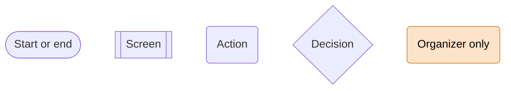
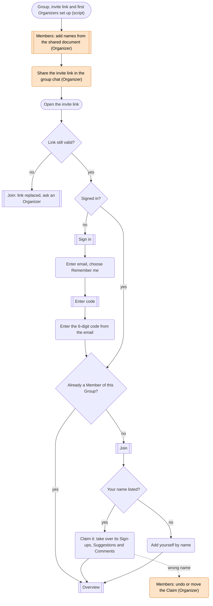
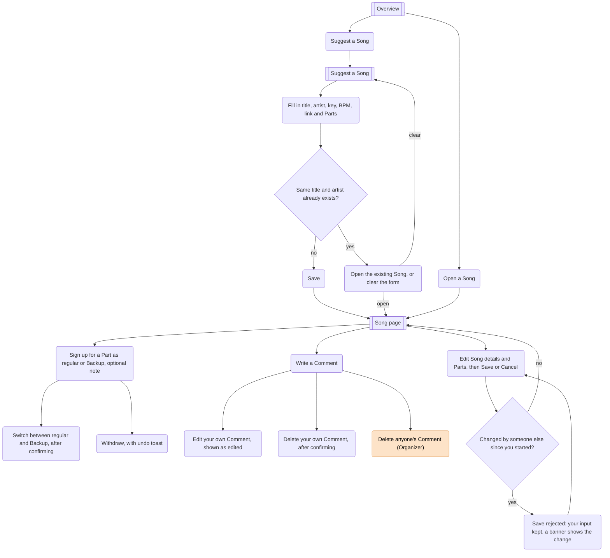
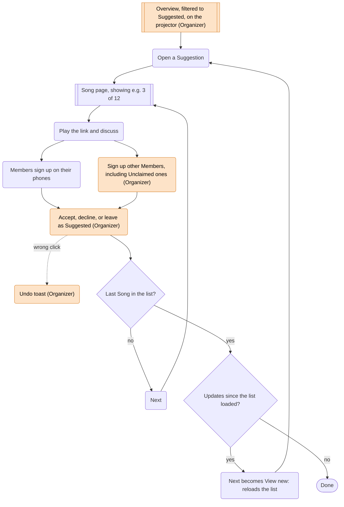
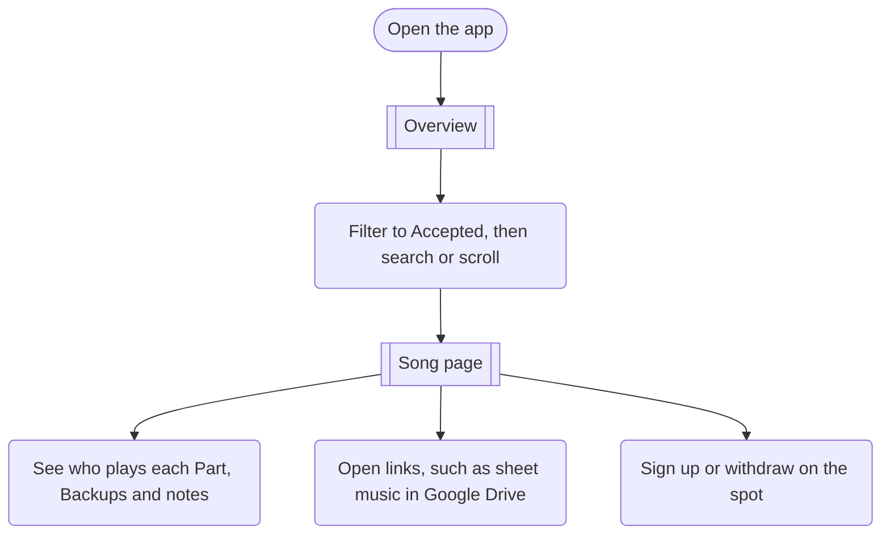
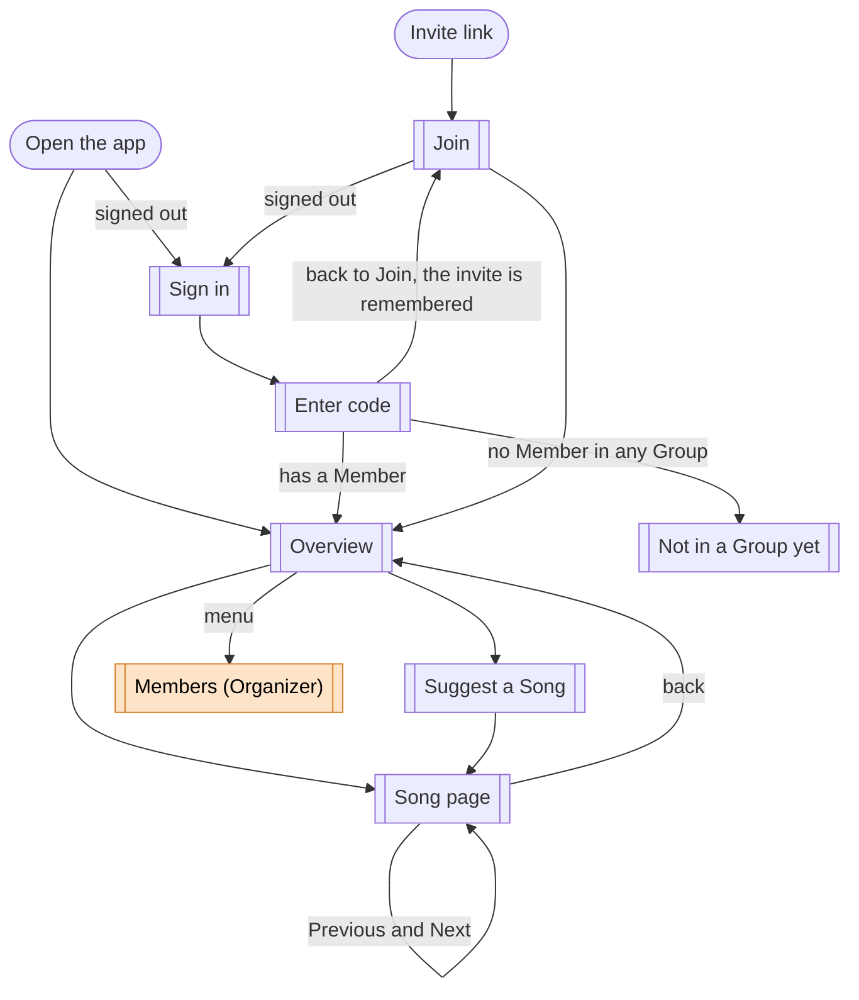

# User journeys for the pilot

This maps how people move through Musialize during the [pilot](vision.md#pilot-review-meeting-12-november-2026). It is a map, not a spec: details belong in tickets. Terms are defined in [GLOSSARY.md](../../GLOSSARY.md).

## Legend

## 1. Joining

Organizers Claim their names through the invite link like everyone else; the Organizer role itself is assigned by script, both at the start and whenever an Organizer is added or removed. Members can't switch names themselves; only an Organizer corrects a Claim. Opening the app without a valid session goes to Sign in and then to the Overview. Someone who signs in without ever using an invite link sees "You're not in a Group yet, ask for an invite link".

## 2. Between meetings

At home, on desktop or phone. Any Member can edit a Song's details and Parts.

A Backup is allowed on any Part, including one with nobody on it, so a Member who plays several instruments can mark the Parts they could take. A Part with only Backups counts as open and shows who could play it. Line-up changes never conflict with edit mode. How signing up looks on the Song page (buttons, a menu or a sheet, and fitting Parts, Sign-ups and notes on a phone) is decided when that screen is designed.

The Overview shows the fill status of required Parts ("4/6", or Filled), plus a separate hint for optional Parts that have no regular Sign-up. How that hint looks (an icon with a count, for example) is left to the screen design.

## 3. Review Meeting

A projector shows an Organizer's screen and everyone also has the app open on their phone. Each device navigates on its own.

**Lists change only when you ask.** The Overview is sorted newest first. While it's open, the Songs in it update live (fill status, status, details), but none are added, removed or reordered. The list reloads when you open the app, change the filter, or reach the end: on the last Song, Next becomes "View new" when there are updates since the list loaded. Previous and Next follow the same list, so a Song that was just accepted stays where it is and Next still works. There is no banner for updates in the pilot; "View new" covers going through the list in the Review Meeting. Live updates therefore only refresh data and never move rows.

The decision has no preconditions: an Organizer can accept a Song that isn't Filled, and can change the decision later. Right after deciding, an undo toast fixes a wrong click in one tap. The Song shows the decision date, and every change is recorded in Song activity.

## 4. Rehearsal

On a phone, in a room where the Song is about to be played.

## Screen map

Each node is a screen. Edit mode, sign-up menus and the duplicate warning live inside the screen they belong to.

The Overview header holds the Group's name and logo and a menu with "Sign out", plus "Members" for Organizers. The pilot has one Group, so there is no Group picker yet.

## Later

Not part of the pilot, but noted so the journeys can grow into them:

- **Create an Unclaimed Member inline** while signing someone up, with a dialog that asks the Organizer to check the spelling of a new name.
- **Tell Backups when a Part opens up** because its last regular player withdrew (needs notifications).
- **An in-app indicator for list updates**, such as a banner or a refresh button with a count. This belongs with live updates, not notifications; it was cut only to keep the pilot small.
- **Notify Members about new Suggestions**, outside the app.
