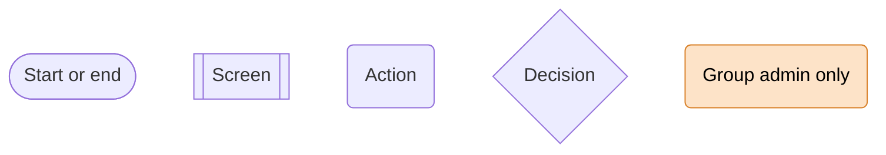
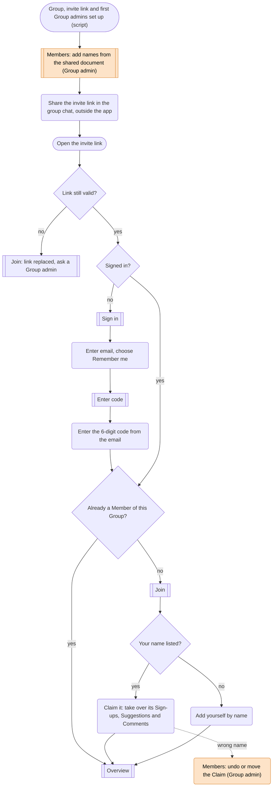
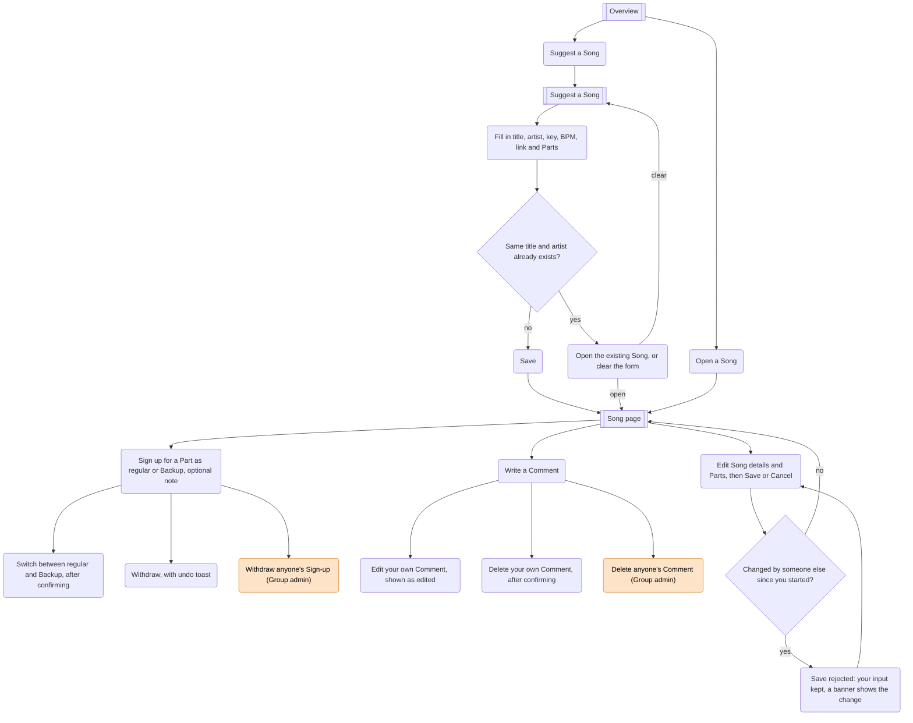
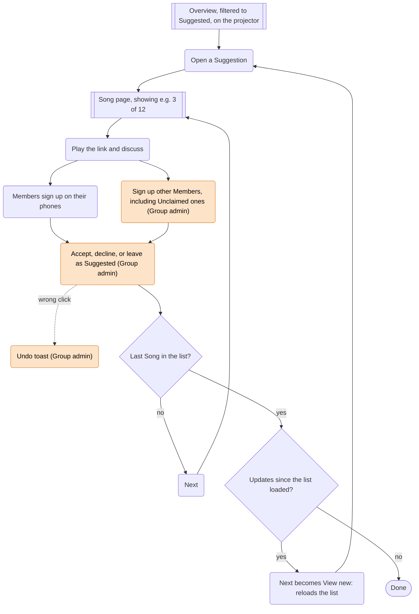
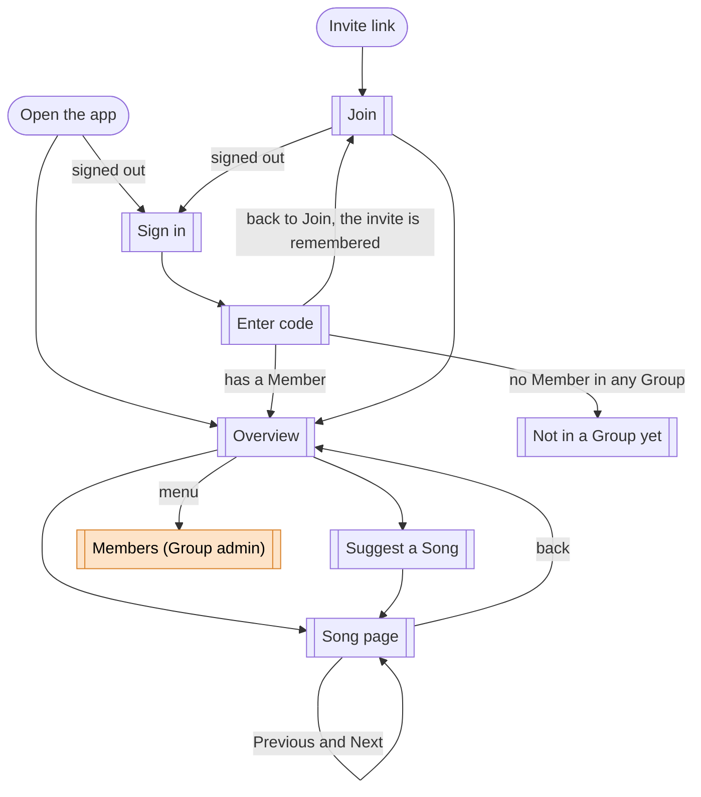

# User journeys for the pilot

This maps how people move through Musialize during the [pilot](vision.md#pilot-review-meeting-12-november-2026). It is a map, not a spec: details belong in tickets. Terms are defined in [GLOSSARY.md](../../GLOSSARY.md).

## Legend

## 1. Joining

Group admins Claim their names through the invite link like everyone else; the Group admin role itself is assigned by script, both at the start and whenever a Group admin is added or removed. Members can't switch names themselves; only a Group admin corrects a Claim. Opening the app without a valid session goes to Sign in and then to the Overview. Someone who signs in without ever using an invite link sees "You're not in a Group yet, ask for an invite link": a route guard sends an Account without a Member there.

## 2. Between meetings

At home, on desktop or phone. Any Member can edit a Song's details and Parts.

A Backup is allowed on any Part, including one with nobody on it, so a Member who plays several instruments can mark the Parts they could take. A Part with only Backups counts as open and shows who could play it. Line-up changes never conflict with edit mode. How signing up looks on the Song page (buttons, a menu or a sheet, and fitting Parts, Sign-ups and notes on a phone) is decided when that screen is designed.

The Overview shows the fill status of required Parts ("4/6", or Filled), plus a separate hint for optional Parts that have no regular Sign-up. How that hint looks (an icon with a count, for example) is left to the screen design.

## 3. Review Meeting

A projector shows a Group admin's screen and everyone also has the app open on their phone. Each device navigates on its own.

**Each filter has its own order**, and the Overview shows which one is in use (for example "Oldest first"):

- **Suggested:** oldest first. It's a queue to review in order, and new Suggestions join at the end.
- **Accepted:** by title, A to Z, so a Song is easy to find at a Rehearsal.
- **Declined:** most recently decided first.

**Lists change only when you ask.** While it's open, the Songs in it update live (fill status, status, details), but none are added, removed or reordered. The list reloads when you open the app, change the filter, or reach the end: on the last Song, Next becomes "View new" when there are updates since the list loaded. Previous and Next follow the same list, so a Song that was just accepted stays where it is and Next still works. There is no banner for updates in the pilot; "View new" covers going through the list in the Review Meeting. Live updates therefore only refresh data and never move rows.

The decision has no preconditions: a Group admin can accept a Song that isn't Filled, and can change the decision later. Right after deciding, an undo toast fixes a wrong click in one tap. The Song shows the decision date, and every change is recorded in Song activity.

## 4. Rehearsal

On a phone, in a room where the Song is about to be played.

## Screen map

Each node is a screen. Edit mode, sign-up menus and the duplicate warning live inside the screen they belong to.

The Overview header holds the Group's name and logo and a menu with "Sign out", plus "Members" for Group admins. The pilot has one Group, so there is no Group picker yet.

## Must-haves by screen

Every [pilot must-have](vision.md#pilot-review-meeting-12-november-2026) maps to a screen, and every screen serves one.

| Screen              | Must-haves                                                                                                                                                   |
| ------------------- | ------------------------------------------------------------------------------------------------------------------------------------------------------------ |
| Sign in, Enter code | Sign-in with an email one-time code                                                                                                                          |
| Join                | Claiming through an invite link, adding yourself                                                                                                             |
| Not in a Group yet  | Sign-in (the dead end for an Account without a Member)                                                                                                       |
| Overview            | Fill status and optional hint, filters and their order, search, live updates and "View new"                                                                  |
| Suggest a Song      | Suggesting a Song, duplicate check                                                                                                                           |
| Song page           | Sign-ups and Backups, withdrawing with undo, Group admins signing up others, Comments, accept or decline with undo, edit mode and rejected saves, live updates |
| Members             | Adding Unclaimed Members, undoing or moving a Claim                                                                                                          |

Song activity is recorded but has no screen yet. Responsiveness, translation-ready text and branding apply to every screen.

## Group admin actions

These become permission rules in the specs. Everything else any Member can do, including editing a Song's details and Parts.

- Open the Members screen: add Unclaimed Members, undo or move a Claim.
- Sign up other Members, including Unclaimed ones, and withdraw anyone's Sign-up.
- Accept or decline a Song, and change that decision later.
- Delete anyone's Comment.

Assigning the Group admin role, creating the Group and replacing the invite link happen by script in the pilot, not in the app.

## Pilot features

Each feature is one unit to grill and wireframe together, ending in one spec issue (see [Order within a feature](../process.md#order-within-a-feature)). They're listed in build order: each one depends only on features above it. The cut order is the vision's "If time runs short" list. A feature with a cut item builds that item as a separate ticket, last within the feature.

| #   | Feature            | Screens                                             | Must-haves                                                                                                                                                                    | Depends on       | Cut order                           |
| --- | ------------------ | --------------------------------------------------- | ----------------------------------------------------------------------------------------------------------------------------------------------------------------------------- | ---------------- | ----------------------------------- |
| 1   | Sign-in and Claim  | Sign in, Enter code, Join, Not in a Group yet       | Sign-in with an email code; Claiming through an invite link, adding yourself                                                                                                  | Walking skeleton | Never cut                           |
| 2   | Songs and Line-ups | Suggest a Song, Song page (details, Parts, Line-up) | Suggesting a Song with Parts and the duplicate check; Sign-ups, Backup and withdrawing; Group admins signing up others and withdrawing anyone's Sign-up; Song activity recorded | 1                | Duplicate check cut 2nd, Backup 3rd |
| 3   | Overview           | Overview                                            | Fill status and optional hint, filters and their order, search                                                                                                                | 2                | Never cut                           |
| 4   | Review Meeting     | Song page (decision, Previous and Next)             | Accepting or declining, decision date, undo toast                                                                                                                             | 3                | Never cut                           |
| 5   | Comments           | Song page (Comments)                                | Comments: write, edit, delete; Group admins delete anyone's                                                                                                                     | 2                | Never cut                           |
| 6   | Edit mode          | Song page (edit mode)                               | Edit mode with Save/Cancel and rejected saves                                                                                                                                 | 2                | Never cut                           |
| 7   | Live updates       | Overview, Song page                                 | Live updates, lists that change only when you ask, "View new"                                                                                                                 | 3, 4, 6          | Cut 4th, last                       |
| 8   | Members            | Members                                             | Members screen: add Unclaimed Members, undo or move a Claim                                                                                                                   | 1                | Cut 1st; scripts take over          |

Notes on the order:

- **Group admins signing up others sits in Songs and Line-ups**, not the Review Meeting, so the Line-up rules are grilled and specced once.
- **Edit mode and live updates are separate features:** live updates are cut last but are the riskiest technically (SignalR), and edit mode works without them.
- **Members comes last** because it's cut first: until then, the script adds Unclaimed Members and fixes Claims.

Must-haves that don't belong to a single feature:

- **Song activity recorded** sits in Songs and Line-ups, which builds the recording and the first entries (Sign-ups, withdrawals). Review Meeting adds status changes and Edit mode adds Part changes. The vision's open question on how activity is recorded must be settled before feature 2.
- **Responsive layout and translation-ready text** isn't a feature: the walking skeleton sets it up, and every feature's spec and review check it.
- **Deployed via CI/CD, with branding from deployment settings** belongs to the walking skeleton.

## Later

Not part of the pilot, but noted so the journeys can grow into them:

- **Create an Unclaimed Member inline** while signing someone up, with a dialog that asks the Group admin to check the spelling of a new name.
- **Tell Backups when a Part opens up** because its last regular player withdrew (needs notifications).
- **An in-app indicator for list updates**, such as a banner or a refresh button with a count. This belongs with live updates, not notifications; it was cut only to keep the pilot small.
- **Notify Members about new Suggestions**, outside the app.
